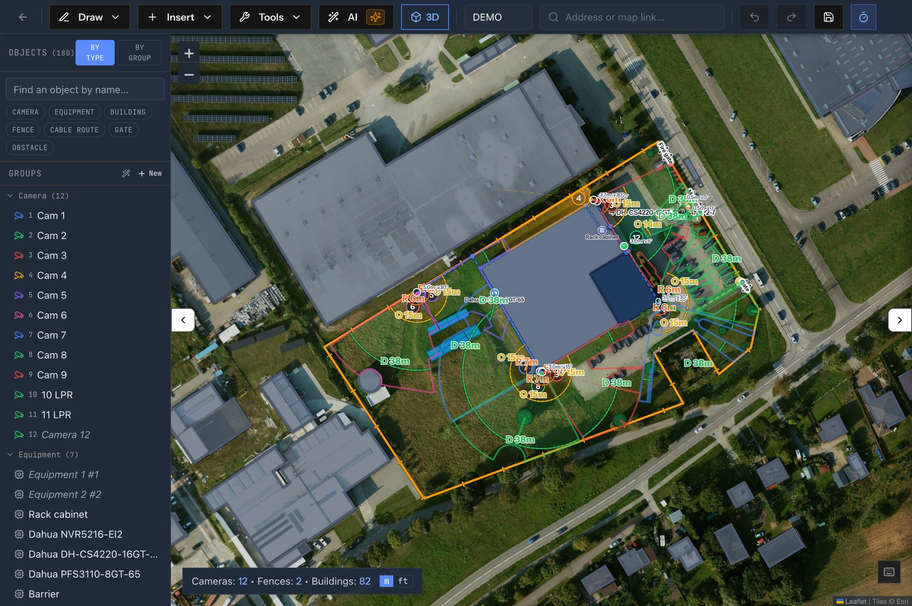

# Aleksander Kubiak

Co-founder of **DEFENSAR Technology**, Gdańsk. I build software for the physical security industry: alarm monitoring, CCTV video analytics and security system design.

Most of my work happens in private company repositories.

## What I'm building

### [CCTVplanner.io](https://cctvplanner.io)

Browser-based CCTV system design, from the first camera to a signed client offer. Place cameras on a satellite map or floor plan, see the field of view and DORI zones computed from real lens optics, plan cable routes, check coverage in 3D, then export a PDF report, a DXF drawing and a quote. Catalogue of 66,000+ camera models, DXF and IFC import, multiple languages, free plan available.

`TypeScript` `React` `Three.js` `CesiumJS` `Leaflet` `PostgreSQL`

### DEFENSAR Operis

Multi-tenant platform for security companies and alarm receiving centres. At its core is the monitoring console: it receives alarm panel signals (SIA DC-09, STAM, ONVIF), turns them into operator events, supervises panel connectivity and keeps a full audit trail. Around it: CRM with e-invoicing (KSeF), a client portal, a mobile patrol app with NFC/QR checkpoints, and fleet tracking.

`TypeScript` `React` `Node.js` `PostgreSQL` `Redis` `Docker` `Capacitor`

### DEFENSAR AI Vision

Pre-alarm verification for CCTV. Most camera pre-alarms are false: wind, rain, animals, insects on the lens. A YOLO detector and zone filter discard those, a local vision-language model (Qwen2-VL-7B) describes the real ones, and the verdict reaches the operator console in about a second.

`Python` `PyTorch` `Ultralytics YOLO` `OpenCV` `Transformers` `FastAPI`

## Open source

In my spare time I take apart the BMW iDrive 7 (MGU) head unit.

- [cauliflowermossgrape/idrive7-8-ssh-root#53](https://github.com/cauliflowermossgrape/idrive7-8-ssh-root/pull/53): read-only preflight command that backs up the car's coding before anything gets flashed *(merged)*
- [robertnisipeanu/idrive-apps#116](https://github.com/robertnisipeanu/idrive-apps/pull/116): cluster-render rejects a malformed upload cap instead of silently turning the limit off

## Contact

- **Me:** [aleksander.kubiak@defensar.pl](mailto:aleksander.kubiak@defensar.pl) · [LinkedIn](https://www.linkedin.com/in/aleksander-kubiak-6816202b8/)
- **CCTVplanner.io:** [cctvplanner.io](https://cctvplanner.io) · [contact@cctvplanner.io](mailto:contact@cctvplanner.io)
